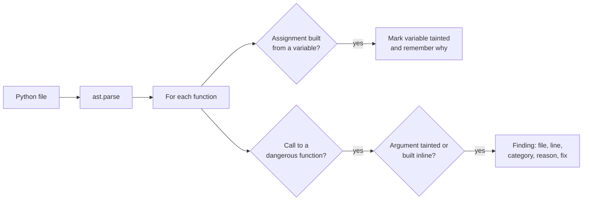
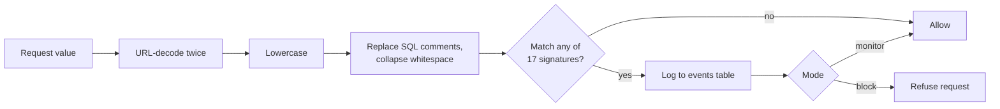

# sqli-guard: technical report

Mohamed Hedi Mahroug · SPbSUT, 10.03.01 Information Security · 2026

## 1. Summary

sqli-guard is a small defensive toolkit for Python web applications. It has
two independent parts:

- a **static checker** that reads source code and reports five classes of
  injection-style and crypto/serialization mistakes, each with a suggested
  fix;
- a **runtime detector** that inspects incoming request values for
  SQL-injection signatures, logs every match and can block the request.

A local Flask lab with a vulnerable and a fixed login exercises both parts.
The project started as a coursework CTF task on SQL injection and was then
extended into a reusable checker.

| Component | Result |
|---|---|
| Runtime detector, development set (tuned on it) | recall 91.0% (61/67), 0 false alarms (0/58) |
| Runtime detector, held-out set (never tuned on) | recall 79.2% (19/24), 0 false alarms (0/19) |
| Static checker, self-written benchmark | 21/21 vulnerable caught, 0/17 safe flagged |
| Test suite | 40 tests, run in CI on every push |

The held-out figure is the one to quote. Section 5 explains why.

## 2. Problem

Injection bugs come from one pattern: data from outside the program is
mixed into something that will be interpreted as code (a SQL query, a shell
command, a file path, a serialized object). The safe alternatives are well
known (parameterized queries, argument lists, path validation, safe
loaders), but the unsafe version is shorter to write, so it keeps
appearing. Two complementary defences follow:

1. catch the unsafe pattern in the code before it ships (static analysis);
2. watch live traffic for attempts to exploit it (runtime detection).

Neither replaces fixing the code. The runtime detector is a first layer
only.

## 3. Design

### 3.1 Static checker (`checker.py`)



The checker never executes code. It parses each file into an abstract
syntax tree with Python's `ast` module and walks every function.

**Sources.** An expression counts as built from variable data when it is
string concatenation with a non-constant, an f-string with an embedded
value, `str.format()`, `%` formatting, or `os.path.join()` with a
non-constant part. When such an expression is assigned to a name, the name
is recorded as tainted together with the reason.

**Sinks.** Each call node is passed to five detectors:

| Category | Sinks | Suggested fix |
|---|---|---|
| SQL injection | `execute`, `executemany`, `executescript` | parameterized query |
| Command injection | `os.system`, `os.popen`, `subprocess.*` with `shell=True` | argument list, no shell |
| Path traversal | `open`, `os.remove`, `os.unlink`, `send_file`, `send_from_directory` | resolve with `realpath` and check it stays under a base directory |
| Weak password hashing | `hashlib.md5` / `sha1` on a variable named like a password or secret | bcrypt, scrypt or `pbkdf2_hmac` |
| Insecure deserialization | `pickle.load(s)` on non-literal data; `yaml.load` without `SafeLoader` | json, or `yaml.safe_load` |

A finding is reported when a sink receives a tainted variable or an
expression built inline from variable data.

### 3.2 Runtime detector (`signatures.py`, `detector.py`)



Signatures are regular expressions stored in a SQLite table with a name,
attack type and severity, so new ones can be added without code changes.
Each request value is normalised first, because the same input can be
written in many encodings. Every match is written to an `events` table
with time, IP, user agent, field and signature.

Bot signals are recorded alongside: a known scanner User-Agent, a high
request rate from one IP, and several different matching payloads from one
IP within a short window.

### 3.3 Lab (`lab/app.py`)

A Flask login backed by an in-memory SQLite database, with a vulnerable
implementation (query built by concatenation) and a fixed one
(parameterized), and the detector in `off`, `monitor` or `block` mode. It
binds to 127.0.0.1 only.

## 4. Implementation notes

- Pure Python standard library plus Flask for the lab; no external
  analysis frameworks.
- Taint tracking is deliberately simple: one assignment step, inside one
  function. This keeps the checker small and its behaviour easy to predict.
- All five detectors share the same helpers (`built_from_variable`,
  `how_built`, `arg_reason`), so a fix to source recognition improves every
  category at once. For example, recognising `os.path.join()` as a source
  fixed path-traversal detection without touching the other detectors.
- The checker runs on its own source in CI and must report nothing there.

## 5. Evaluation

### 5.1 Method

Three labelled sets, each used for one purpose:

| Set | Size | Used for |
|---|---|---|
| `eval/dataset.py` (development) | 67 attack strings, 58 normal inputs | tuning signatures; five versions logged in `CHANGELOG.md` |
| `eval/heldout.py` (held-out) | 24 attack strings, 19 normal inputs | measured once, after signatures were frozen |
| `eval/benchmark_corpus.py` | 21 vulnerable and 17 safe code snippets across 5 categories | checking the static checker's detectors |

Normal inputs include values that look like SQL but are not attacks:
names with apostrophes, passwords with symbols, sentences containing SQL
keywords, and a numeric comparison.

Metrics: recall = attacks detected ÷ all attacks; false-alarm rate =
normal inputs flagged ÷ all normal inputs; precision = correct flags ÷ all
flags.

### 5.2 Results

Runtime detector, tuning history on the development set:

| Version | Change | Recall | False alarms |
|---|---|---|---|
| v1 | initial signatures | 80.6% (54/67) | 0/58 |
| v2 | parenthesised forms | 83.6% (56/67) | 0/58 |
| v3 | stacked queries | 85.1% (57/67) | 0/58 |
| v4 | `or` with comparison operators | 86.6% (58/67) | 0/58 |
| v5 | subquery and convert signatures | 91.0% (61/67) | 0/58 |

Held-out set, measured once with v5: **recall 79.2% (19/24), 0/19 false
alarms.**

Static checker benchmark: 21/21 vulnerable snippets caught, 0/17 safe
snippets flagged, in every category.

### 5.3 Interpretation

The 12-point drop from 91.0% to 79.2% is the expected effect of tuning on
the development set: each signature added in v2–v5 was written after
seeing a miss in that set. The held-out set measures performance on inputs
the signatures were not shaped around, so it is the honest estimate. With
only 24 held-out attacks, the uncertainty is wide (a rough 95% interval
for recall is 60–91%).

The static checker's 100% is weaker evidence still. The same person wrote
the detectors and the snippets, so the benchmark shows the detectors work
as designed and catches regressions in CI. It does not show how the
checker performs on real, unseen code.

## 6. Limitations

- Static checker: taint follows one assignment within one function; data
  passed between functions, through containers or across files is not
  tracked. Weak-hash detection depends on variable names. Only Python is
  supported.
- Runtime detector: signature matching only sees what the normaliser can
  decode, and the held-out set exposed patterns it misses (listed in the
  README). It is a monitoring layer, not a fix. Parameterized queries are
  the real defence.
- All evaluation sets were assembled by the author, and the held-out set
  is now spent: improving on its misses requires a new held-out set.

## 7. Next steps

1. An independently collected held-out set for the static checker.
2. Fix the runtime detector's known misses, then measure on a new held-out
   set.
3. Compare both parts against established tools (Bandit for static
   analysis, the OWASP Core Rule Set for request signatures) on the same
   data.
4. Inter-procedural taint tracking for the checker.

## 8. Reproducing the results

```
pip install flask pytest
python -m pytest tests            # 40 tests
python eval/run_eval.py           # runtime detector, development set
python eval/run_eval.py heldout   # runtime detector, held-out set
python eval/benchmark.py          # static checker benchmark
python checker.py samples/        # checker on the sample files
```

Use only on code and systems you own or are permitted to test.
